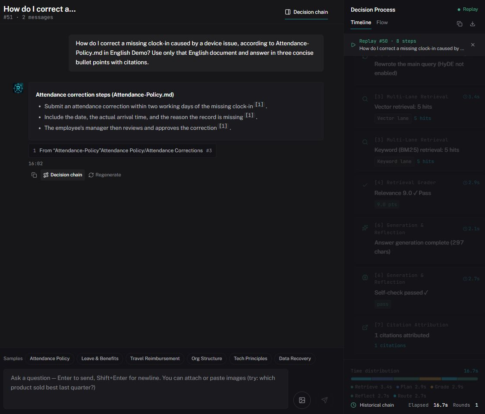
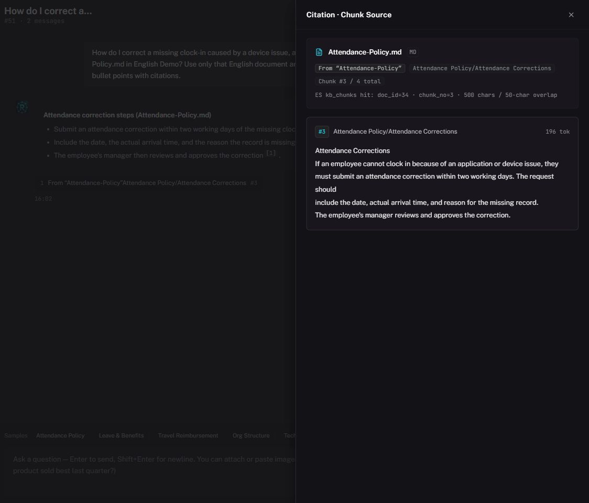
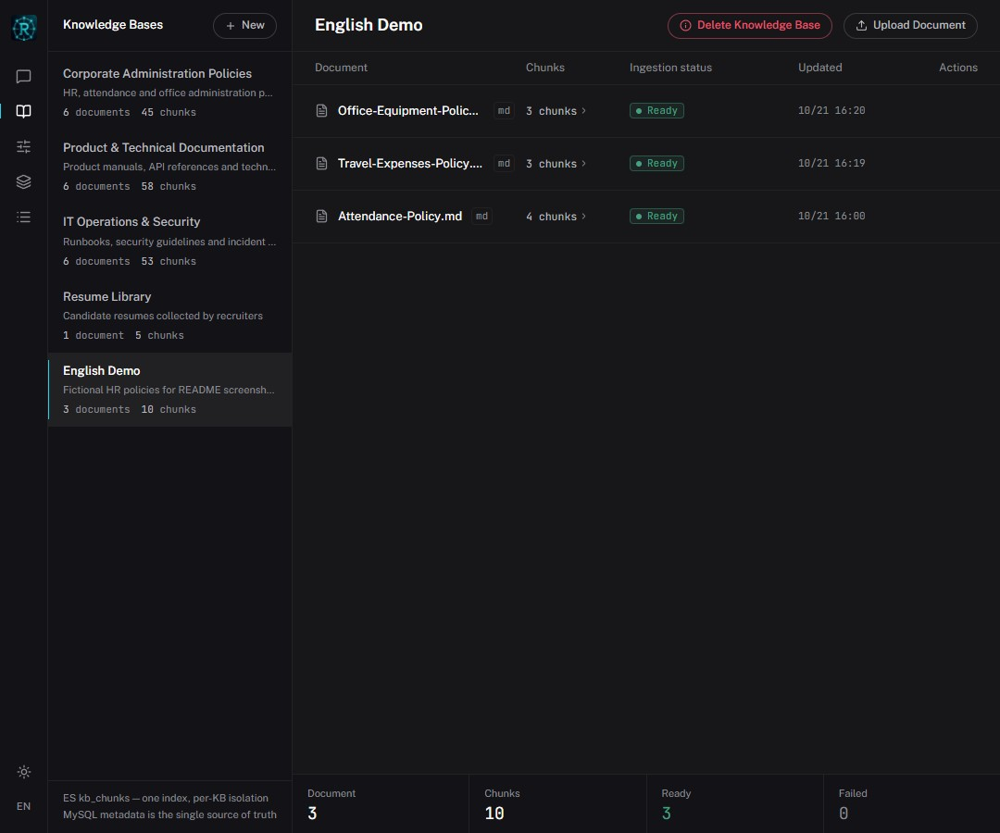
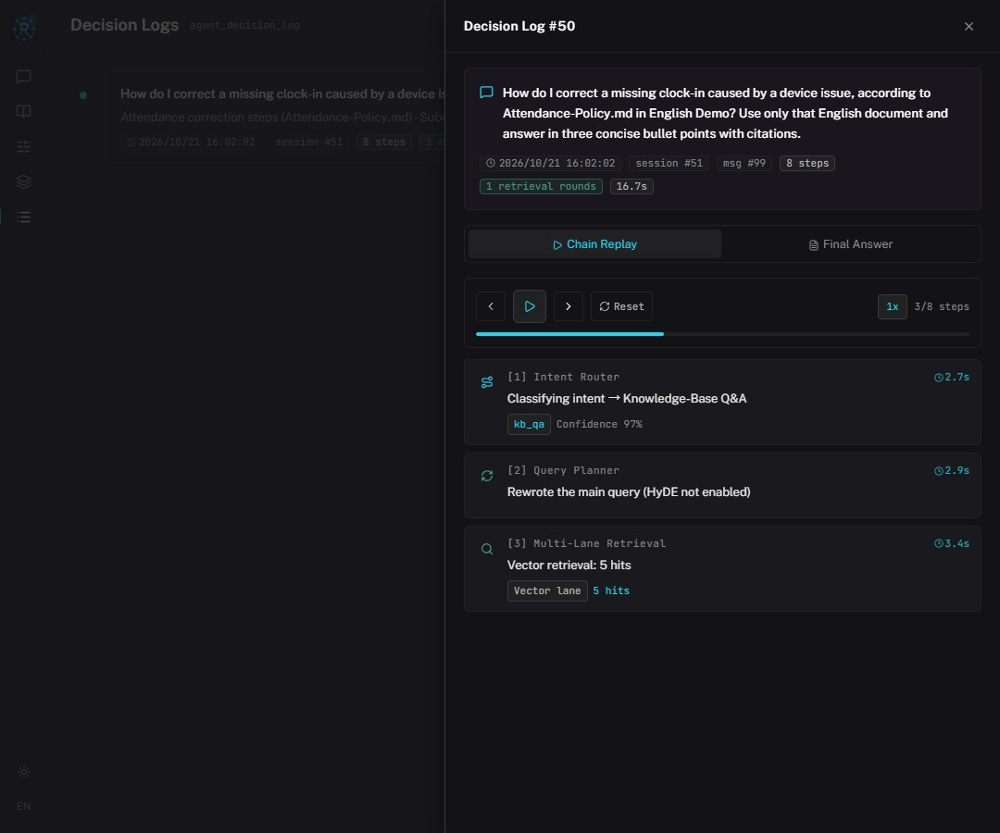
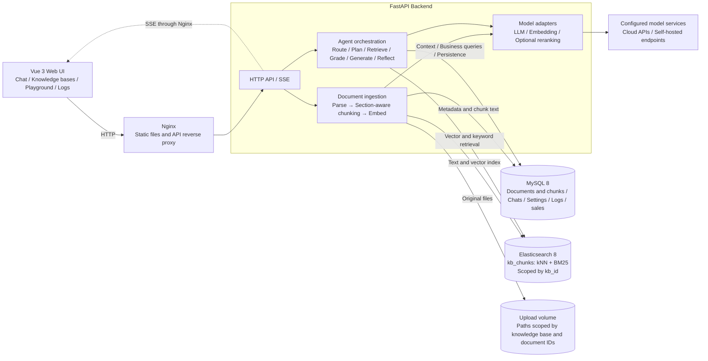
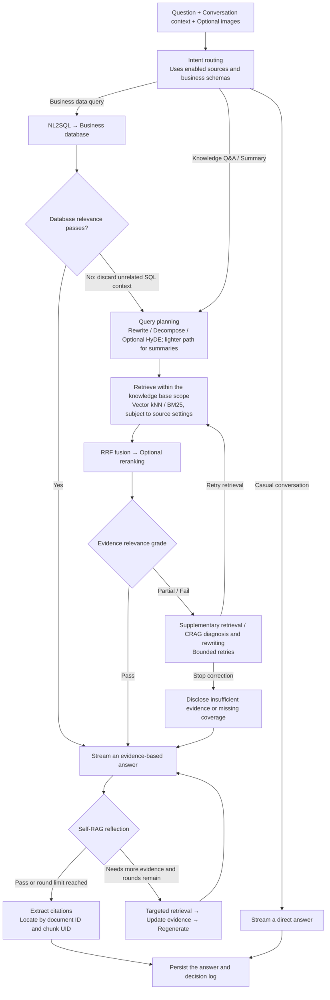

# RAGent

[简体中文](README.md) | English

A RAG question-answering project with multiple knowledge bases, hybrid retrieval, and replayable agent decision traces. The Vue 3 frontend and FastAPI backend use SSE to display retrieval, correction, generation, and reflection as they happen.

## Features

- **Knowledge base management**: Upload Markdown, TXT, PDF, and DOCX files for parsing, section-aware chunking, embedding, and indexing. Browse chunks, retry failed documents, and delete individual documents or entire knowledge bases.
- **Hybrid retrieval**: Combine Elasticsearch vector search and BM25 keyword search through application-level Reciprocal Rank Fusion (RRF), with optional reranking.
- **Agent workflow**: Intent routing, query rewriting and HyDE, relevance grading, CRAG correction, and Self-RAG reflection, with separate paths for casual conversation and business data queries. Routing uses the connected business schemas; insufficiently relevant database results fall back to document retrieval.
- **Source attribution**: Match citation numbers to their sources using document IDs and chunk UIDs, avoiding confusion between documents with the same name. Regeneration after reflection replaces the previous answer.
- **Multimodal conversations**: Ask questions with images, maintain conversation context, regenerate answers, and stop streaming. Image understanding depends on the selected model's vision capabilities.
- **Diagnostic tools**: Retrieval Playground, decision log replay and export, and dependency health checks.
- **Chinese and English interfaces**: Switch the interface language; the answer language is determined from the question.

## Feature Gallery

These screenshots show the running application with the interface set to English. The demo knowledge base is loaded with the fictional policies in [test_docs/en/](test_docs/en): an attendance policy, a travel expenses policy, and an office equipment policy. Questions, answers, source text, and decision traces are in English. Click an image to open the original.

| Knowledge Q&A and decision trace | Citations and source text |
| --- | --- |
| [](docs/images/en/chat.jpg) | [](docs/images/en/citation.jpg) |
| Read sourced answers and replay routing, planning, retrieval, grading, and reflection. | Open a citation number or source card to locate the original document and chunk. |

| Knowledge bases and documents | Decision log replay |
| --- | --- |
| [](docs/images/en/knowledge-bases.jpg) | [](docs/images/en/decision-log.jpg) |
| Manage multiple libraries, upload files, inspect chunks, retry failed jobs, and delete a knowledge base. | Filter by session and date, then inspect step timings, retrieval results, and the final answer. |

Deleting a knowledge base requires confirmation and is blocked while its documents are being processed. Cleanup is scoped by knowledge base ID and removes its documents, chunks, ES data, and upload directory. Independently uploaded copies in other knowledge bases remain intact, even when their names or contents match.

## Technology and Workflow

| Layer | Implementation |
| --- | --- |
| Frontend | Vue 3, TypeScript, Vite, Pinia, Tailwind CSS, vue-i18n |
| Backend | Python, FastAPI, Pydantic, HTTPX, SSE |
| Metadata | MySQL 8: documents, chunks, conversations, data source settings, and decision logs |
| Search index | Elasticsearch 8: dense vector kNN and BM25; falls back to the standard analyzer when IK is unavailable |
| Model APIs | OpenAI-compatible interfaces; adapters live in `backend/app/providers/` |
| Deployment | Docker Compose, Nginx |

Document ingestion: `Upload → Parse → Chunk → Embed → Elasticsearch + MySQL`.

Knowledge Q&A: `Route intent → Plan query → Retrieve from both lanes → RRF / optional reranking → Grade / correct → Stream answer → Reflect → Attribute sources`.

MySQL stores metadata and chunk text, Elasticsearch holds a rebuildable search index, and original uploads are stored in a separate data directory.

### System Architecture



FastAPI background tasks run document ingestion, while the frontend polls for document status. Q&A events stream through SSE. MySQL, Elasticsearch, and uploaded files use separate data volumes. `backend/app/agent/source_catalog.py` describes the business database query capability.

### Question Processing Flow



Summaries prefer vector retrieval. When reflection exhausts its rounds without passing, the answer includes a note. New citations resolve to the original document and chunk, preventing confusion between identically named documents across knowledge bases.

## Run with Docker Compose

You need Git, Docker, Docker Compose, and access to an LLM and an embedding service.

### 1. Clone and Configure

```bash
git clone https://github.com/NicoYazawa/RAGent.git
cd RAGent
```

Copy the root `.env.example` to `.env`:

```bash
# macOS / Linux
cp .env.example .env
```

```powershell
# Windows PowerShell
Copy-Item .env.example .env
```

Edit `.env` and supply at least `DEEPSEEK_API_KEY` and `DASHSCOPE_API_KEY`, or select other supported providers. The default configuration uses DeepSeek for answer generation and Alibaba Cloud Model Studio for 1024-dimensional embeddings. Model names are project configuration defaults; use models available to your own service account.

Change the example database password and keep `MYSQL_PASSWORD` and `MYSQL_ROOT_PASSWORD` identical. Git ignores `.env`; do not commit real API keys.

### 2. Start the Services

```bash
docker compose up -d --build
docker compose ps
```

| Address | Purpose |
| --- | --- |
| `http://localhost` | Web interface |
| `http://localhost/api/health` | Backend dependency status and index consistency |
| `127.0.0.1:3306` | MySQL, bound to the host loopback interface only |
| `http://127.0.0.1:9200` | Elasticsearch, bound to the host loopback interface only |

### 3. Initialize the Demo Search Data

`ragent_init.sql` is imported automatically **when the MySQL data volume is first initialized**. It includes demo knowledge base chunks, sales data, and conversation history. It is not an empty-schema-only script and does not populate vectors in a new Elasticsearch volume.

To use the demo knowledge bases for the first time, configure your embedding API key and run:

```bash
docker compose exec backend python -m scripts.backfill_es_from_mysql
```

This command calls the real embedding service, incurs the associated charges, and rebuilds the ES index from MySQL chunks. Afterwards, check `status` and `consistency` in `/api/health`. You can also create a knowledge base in the interface and upload files from `test_docs/` to try the complete ingestion workflow.

Historical upload paths and image references in the seed SQL do not mean those files exist in the current volume. Re-upload documents if you need their original files or want to retry the full parsing workflow.

### Common Operations

```bash
docker compose logs -f backend
docker compose logs -f es
docker compose down
```

The regular `down` command preserves data volumes. `docker compose down -v` deletes the MySQL, ES, and upload volumes; use it only when you intend to clear that data.

## Local Development

Use **Python 3.12** for the backend. The frontend requires **Node.js 20.19+ or 22.12+**; Node.js 22 is recommended. Use existing MySQL and ES instances, or configure the root `.env` and run `docker compose up -d db es`.

### Backend

From the project root, create a virtual environment:

```bash
python -m venv .venv
```

```powershell
# Windows PowerShell
.\.venv\Scripts\Activate.ps1
```

```bash
# macOS / Linux
source .venv/bin/activate
```

Install dependencies and copy `backend/.env.example` to `backend/.env`:

```bash
python -m pip install -r backend/requirements.txt -r backend/requirements-dev.txt
```

The local backend reads **`backend/.env`**; the Compose backend reads the root **`.env`**. These are separate configurations. To connect the local backend to the Compose database, set the same database password in `backend/.env`, along with `MYSQL_HOST=localhost`, `ES_URL=http://localhost:9200`, `ES_USER=`, and `DATA_DIR=data`.

If you run MySQL separately, create a UTF-8 database first, then import `ragent_init.sql` into it. The script contains `DROP TABLE` statements and should only be imported into a new demo database.

```bash
cd backend
python run.py
```

The backend runs at `http://127.0.0.1:8000`; interactive API documentation is available at `http://127.0.0.1:8000/docs`. Use `python run.py --port 8001` to change the port, and update the frontend development proxy accordingly.

### Frontend

In another terminal:

```bash
cd frontend
npm ci
npm run dev
```

Open `http://localhost:5173`. Vite proxies `/api` requests to the local backend on port 8000.

## Configuration

See the two `.env.example` files and `backend/app/config.py` for the full configuration.

| Variable | Purpose |
| --- | --- |
| `LLM_PROVIDER` / `EMBED_PROVIDER` | Select model providers; defaults to `deepseek` / `qwen` when unset |
| `LLM_MODEL` / `EMBED_MODEL` / `EMBED_DIMS` | Override catalog models or embedding dimensions; leave empty to use catalog defaults |
| `LLM_BASE_URL` / `EMBED_BASE_URL` | Override API URLs for gateways or self-hosted services |
| `RERANK_ENABLED` / `RERANK_PROVIDER` | Enable reranking with `qwen` or `siliconflow`; disabled by default |
| `MYSQL_HOST` / `MYSQL_PORT` / `MYSQL_USER` / `MYSQL_PASSWORD` / `MYSQL_DB` | Application database connection |
| `ES_URL` / `ES_USER` / `ES_PASSWORD` | Elasticsearch connection |
| `CORS_ORIGINS` | Comma-separated allowed origins; wildcard `*` is rejected |
| `DATA_DIR` | Upload directory; relative paths resolve against `backend` |
| `OVERALL_TIMEOUT` | Total timeout for a question, in seconds; defaults to 120 |

LLM adapters include `deepseek`, `qwen`, `openai`, `moonshot`, `zhipu`, `siliconflow`, and `ollama`. Embedding adapters include `qwen`, `openai`, `siliconflow`, and `ollama`. Model capabilities and defaults are defined in `backend/app/providers/registry.py`.

When switching providers, clear outdated model and URL overrides, especially the legacy variables `DEEPSEEK_BASE_URL` and `DASHSCOPE_BASE_URL`. Changing the embedding model requires re-embedding existing chunks. If its dimensions change, rebuild the index with matching dimensions as well; do not mix embeddings from different models in the existing index.

## Project Structure

```text
RAGent/
├── backend/
│   ├── app/agent/        # Q&A orchestration, retrieval, prompts, and RRF
│   ├── app/providers/    # LLM / Embedding / Rerank adapters
│   ├── app/routers/      # Conversation, knowledge base, data source, and log APIs
│   ├── app/services/     # Parsing, chunking, ingestion, and image management
│   ├── scripts/          # Index backfill, rechunking, and retrieval benchmarks
│   └── tests/
├── frontend/src/         # Views, components, stores, and API clients
├── docs/                 # Feature screenshots, internationalization, and regression documentation
├── test_docs/            # Demo documents (test_docs/en holds the English set)
├── elasticsearch/        # Optional image build configuration for the IK plugin
├── docker-compose.yml
└── ragent_init.sql       # Demo database schema and seed data
```
