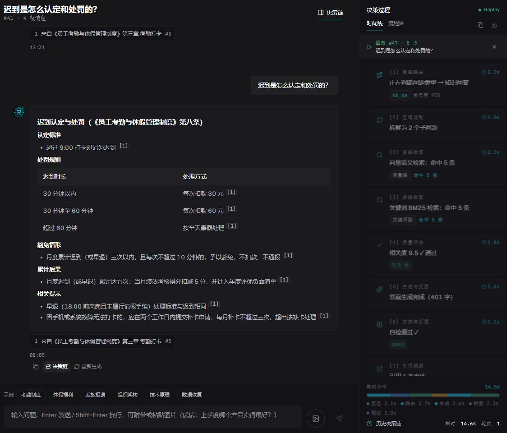
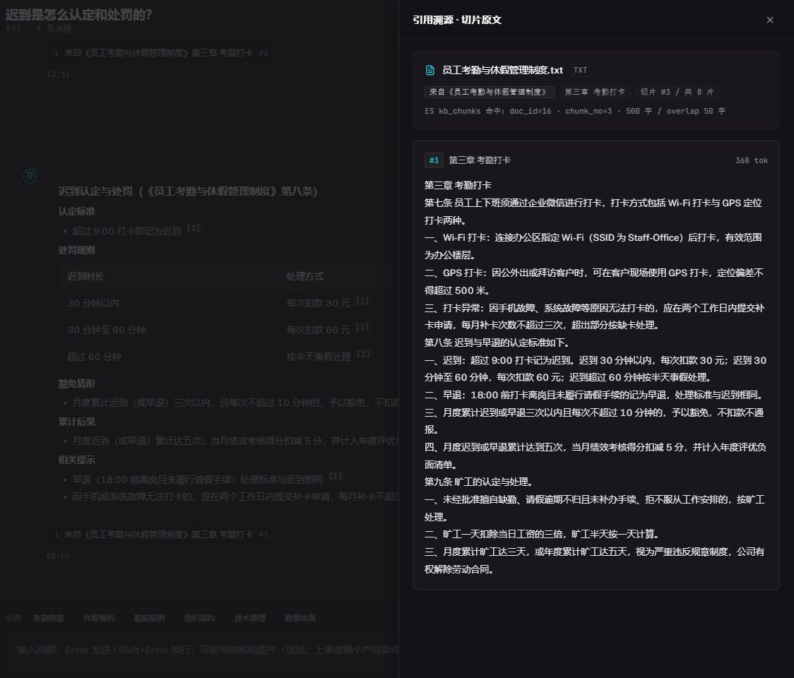
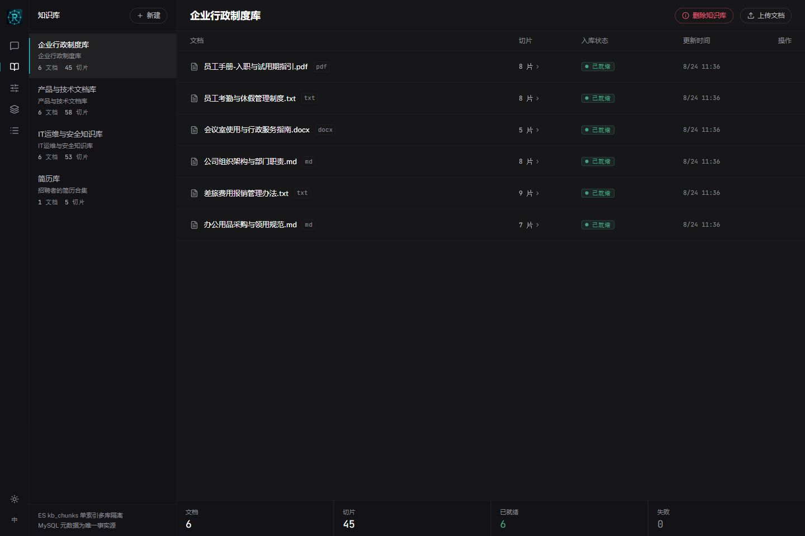
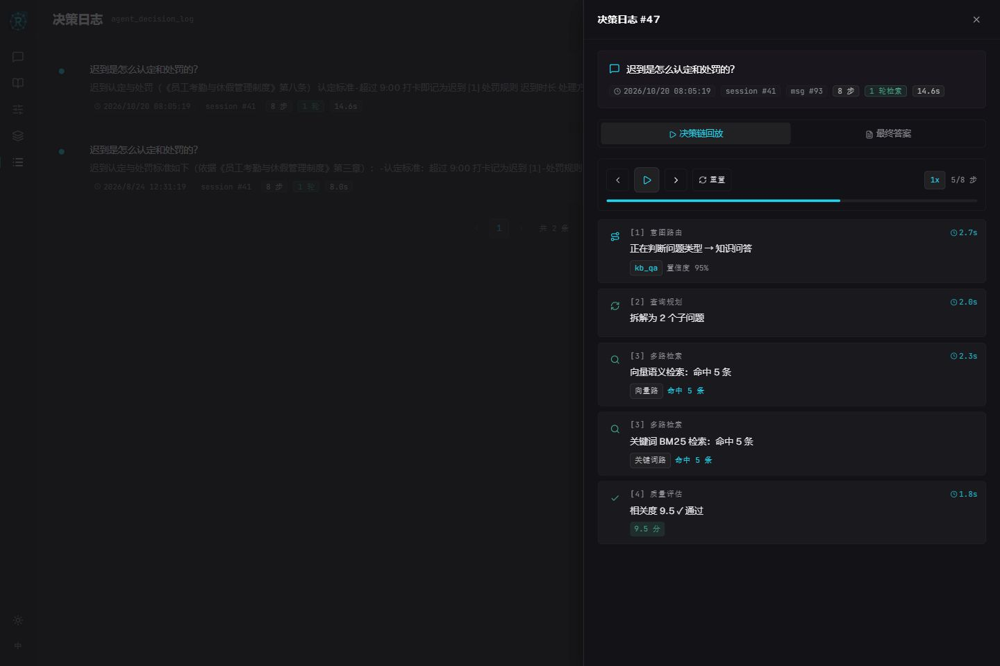
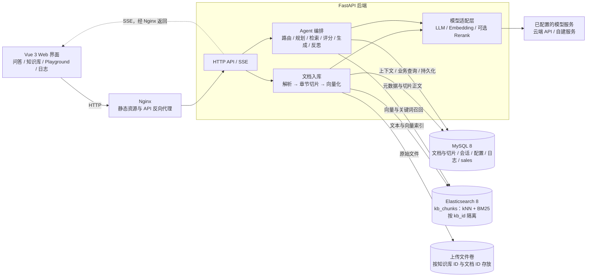
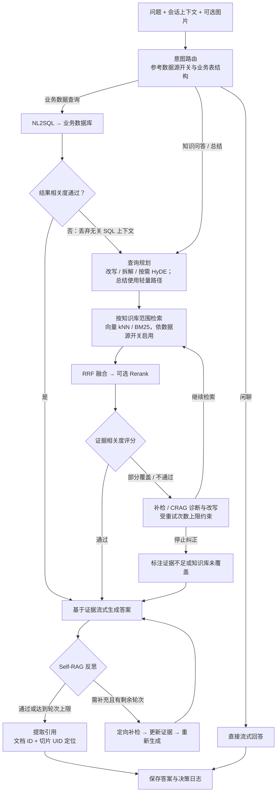

# RAGent

简体中文 | [English](README.en.md)

一个支持多知识库、混合检索和可回放决策链的 RAG 问答项目。前端使用 Vue 3，后端使用 FastAPI，通过 SSE 展示检索、纠正、生成与反思过程。

## 功能

- **知识库管理**：上传 Markdown、TXT、PDF、DOCX，完成解析、章节切片、向量化与索引；支持查看切片、失败重试、删除文档和删除整个知识库。
- **混合检索**：Elasticsearch 向量检索与 BM25 关键词检索，经应用层 RRF 融合，可选启用 Rerank 精排。
- **Agent 问答**：意图识别、查询改写与 HyDE、相关度评分、CRAG 纠正、Self-RAG 反思；另有闲聊和业务数据查询路径。路由参考已接入的业务表结构，数据库结果相关度不足时回退到文档知识库检索。
- **答案溯源**：引用编号与原文对应，使用文档 ID 和切片 UID 定位，避免同名文档混淆；反思重生成会替换旧答案。
- **多模态会话**：支持附图提问、多轮上下文、重新生成及停止输出。图片理解取决于当前模型的视觉能力。
- **诊断工具**：检索 Playground、决策日志回放与导出、依赖健康状态检查。
- **中英文界面**：支持切换界面语言；答案语言依据问题判断。

## 功能演示

以下截图来自本地运行的真实界面，问答与引用使用制度演示数据。英文版使用独立的英语界面与英文演示数据截图，演示文档见 `test_docs/en/`。点击图片可查看原图。

| 智能问答与决策链 | 引用溯源与原文 |
| --- | --- |
| [](docs/images/chat.jpg) | [](docs/images/citation.jpg) |
| 查看带出处的答案，回放路由、规划、检索、评分和反思过程。 | 点击引用编号或出处卡片，按文档和切片身份定位原文。 |

| 知识库与文档管理 | 决策日志回放 |
| --- | --- |
| [](docs/images/knowledge-bases.jpg) | [](docs/images/decision-log.jpg) |
| 管理多个库，上传文档、查看切片、重试失败任务及删除知识库。 | 按会话与日期筛选日志，查看每步耗时、检索结果及最终答案。 |

删除知识库需要二次确认；有文档正在入库时会拒绝删除。删除按知识库 ID 清理文档、切片、ES 数据和上传目录，其他知识库中同名或同内容的独立副本不受影响。

## 技术栈与流程

| 层次 | 实现 |
| --- | --- |
| 前端 | Vue 3、TypeScript、Vite、Pinia、Tailwind CSS、vue-i18n |
| 后端 | Python、FastAPI、Pydantic、HTTPX、SSE |
| 元数据 | MySQL 8：文档、切片、会话、数据源配置与决策日志 |
| 检索索引 | Elasticsearch 8：dense vector kNN、BM25；IK 不可用时回退 standard 分词器 |
| 模型接口 | OpenAI 兼容接口；适配器目录位于 `backend/app/providers/` |
| 部署 | Docker Compose、Nginx |

文档入库：`上传 → 解析 → 切片 → Embedding → Elasticsearch + MySQL`。

知识问答：`意图识别 → 查询规划 → 双路检索 → RRF / 可选精排 → 评分 / 纠正 → 流式生成 → 反思 → 引用溯源`。

MySQL 保存元数据和切片正文，Elasticsearch 保存可重建的检索索引，原始上传文件保存在独立数据目录中。

### 系统架构



入库由 FastAPI 后台任务执行，前端通过轮询刷新文档状态；问答过程通过 SSE 推送。MySQL、ES 与上传文件分别使用独立数据卷，业务数据查询能力由 `backend/app/agent/source_catalog.py` 描述。

### 一个问题的处理流程



总结路径优先使用向量检索；反思达到上限仍未通过时会附加说明。新引用定位到原始文档与切片，避免跨库同名文档串引。

## 使用 Docker Compose 启动

需要 Git、Docker 和 Docker Compose，以及可用的 LLM / Embedding 模型服务。

### 1. 克隆与配置

```bash
git clone https://github.com/NicoYazawa/RAGent.git
cd RAGent
```

复制根目录 `.env.example` 为 `.env`：

```bash
# macOS / Linux
cp .env.example .env
```

```powershell
# Windows PowerShell
Copy-Item .env.example .env
```

编辑 `.env`，至少填写 `DEEPSEEK_API_KEY` 和 `DASHSCOPE_API_KEY`，或者改用其他已适配的供应商。默认配置使用 DeepSeek 生成答案、百炼生成 1024 维向量。模型名称是本项目的配置默认值，请以自己的服务账号实际可用模型为准。

同时修改示例数据库口令，并保持 `MYSQL_PASSWORD` 与 `MYSQL_ROOT_PASSWORD` 一致。`.env` 已被 Git 忽略，不要将真实密钥提交到仓库。

### 2. 启动服务

```bash
docker compose up -d --build
docker compose ps
```

| 地址 | 用途 |
| --- | --- |
| `http://localhost` | Web 界面 |
| `http://localhost/api/health` | 后端依赖状态与索引一致性 |
| `127.0.0.1:3306` | MySQL，仅绑定宿主机回环地址 |
| `http://127.0.0.1:9200` | Elasticsearch，仅绑定宿主机回环地址 |

### 3. 初始化演示检索数据

`ragent_init.sql` 在 **MySQL 数据卷第一次初始化时** 自动导入，包含演示知识库切片、销售数据和历史会话。它不是纯空库建表脚本，也不会向新的 Elasticsearch 数据卷写入向量。

首次使用演示知识库时，配置好 Embedding 密钥后执行：

```bash
docker compose exec backend python -m scripts.backfill_es_from_mysql
```

该命令调用真实 Embedding 服务并产生相应费用，从 MySQL 切片重建 ES 索引。完成后检查 `/api/health` 中的 `status` 和 `consistency`。也可在界面中新建知识库，上传 `test_docs/` 中的文档体验完整入库流程。

初始化 SQL 内的历史上传路径和图片引用不代表当前卷中存在对应文件。需要原始文件或重试完整解析时，请重新上传文档。

### 日常操作

```bash
docker compose logs -f backend
docker compose logs -f es
docker compose down
```

普通 `down` 保留数据卷。`docker compose down -v` 会删除 MySQL、ES 和上传文件卷，仅在明确需要清空数据时使用。

## 本地开发

后端使用 **Python 3.12**；前端需要 **Node.js 20.19+ 或 22.12+**，建议使用 Node.js 22。MySQL 和 ES 可使用已有实例，也可在配置根目录 `.env` 后运行 `docker compose up -d db es`。

### 后端

以下命令在项目根目录执行，先创建虚拟环境：

```bash
python -m venv .venv
```

```powershell
# Windows PowerShell
.\.venv\Scripts\Activate.ps1
```

```bash
# macOS / Linux
source .venv/bin/activate
```

安装依赖，并复制 `backend/.env.example` 为 `backend/.env`：

```bash
python -m pip install -r backend/requirements.txt -r backend/requirements-dev.txt
```

本地后端读取 **`backend/.env`**；Compose 后端读取根目录 **`.env`**。两者是独立配置，不能互相替代。使用 Compose 的数据库时，在 `backend/.env` 中填写相同数据库口令，并使用 `MYSQL_HOST=localhost`、`ES_URL=http://localhost:9200`、`ES_USER=`、`DATA_DIR=data`。

若使用自行安装的 MySQL，先创建 UTF-8 数据库，再在该库内导入 `ragent_init.sql`。导入脚本含 `DROP TABLE`，只应对新建的演示库执行。

```bash
cd backend
python run.py
```

后端地址为 `http://127.0.0.1:8000`，交互式 API 文档为 `http://127.0.0.1:8000/docs`。可用 `python run.py --port 8001` 修改端口；前端开发代理也需同步调整。

### 前端

在另一个终端执行：

```bash
cd frontend
npm ci
npm run dev
```

默认访问 `http://localhost:5173`，`/api` 请求由 Vite 代理至本地后端的 8000 端口。

## 配置说明

详细字段见两个 `.env.example` 和 `backend/app/config.py`。

| 配置项 | 作用 |
| --- | --- |
| `LLM_PROVIDER` / `EMBED_PROVIDER` | 选择模型供应商；未设置时分别为 `deepseek` / `qwen` |
| `LLM_MODEL` / `EMBED_MODEL` / `EMBED_DIMS` | 覆盖供应商目录的模型或向量维度；留空使用目录默认值 |
| `LLM_BASE_URL` / `EMBED_BASE_URL` | 覆盖接口地址，用于网关或自建服务 |
| `RERANK_ENABLED` / `RERANK_PROVIDER` | 启用精排；当前支持 `qwen` 与 `siliconflow`，默认关闭 |
| `MYSQL_HOST` / `MYSQL_PORT` / `MYSQL_USER` / `MYSQL_PASSWORD` / `MYSQL_DB` | 应用数据库连接 |
| `ES_URL` / `ES_USER` / `ES_PASSWORD` | Elasticsearch 连接 |
| `CORS_ORIGINS` | 逗号分隔的允许来源；禁止通配符 `*` |
| `DATA_DIR` | 上传数据目录；相对路径以 `backend` 为基准 |
| `OVERALL_TIMEOUT` | 单次问答总超时，默认 120 秒 |

LLM 适配目录包含 `deepseek`、`qwen`、`openai`、`moonshot`、`zhipu`、`siliconflow`、`ollama`；Embedding 适配目录包含 `qwen`、`openai`、`siliconflow`、`ollama`。模型能力和默认值见 `backend/app/providers/registry.py`。

切换供应商时，应清理旧的模型和地址覆盖值，尤其是历史变量 `DEEPSEEK_BASE_URL` / `DASHSCOPE_BASE_URL`。切换 Embedding 模型后需重新向量化已有切片；维度变化时还需重建匹配维度的索引，不要直接对已有索引混用不同模型的向量。

## 项目目录

```text
RAGent/
├── backend/
│   ├── app/agent/        # 问答编排、检索、提示词和 RRF
│   ├── app/providers/    # LLM / Embedding / Rerank 适配
│   ├── app/routers/      # 会话、知识库、数据源和日志 API
│   ├── app/services/     # 解析、切片、入库和图片管理
│   ├── scripts/          # 索引回填、重切与检索评测
│   └── tests/
├── frontend/src/         # 页面、组件、状态管理和 API 客户端
├── docs/                 # 功能截图、国际化与回归验证说明
├── test_docs/            # 演示文档（test_docs/en 为英文演示集）
├── elasticsearch/        # 可选 IK 插件镜像构建配置
├── docker-compose.yml
└── ragent_init.sql       # 演示数据库建表和种子数据
```
